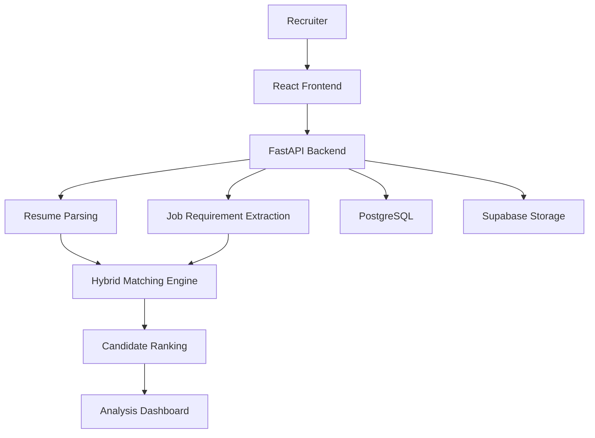

# HireSense
### AI-Based Resume Matching & Candidate Ranking System

HireSense is an AI-powered recruitment application that helps recruiters evaluate resumes against job descriptions, identify relevant candidates, and understand candidate-job compatibility through structured and semantic matching.

**[Live Demo](https://hiresense.pages.dev)** · **[GitHub Repository](https://github.com/Harshini20-20/HireSense)**

## Features

- **Job Management:** Create and manage job descriptions and requirements.
- **Resume Processing:** Upload and process PDF and DOCX resumes.
- **Candidate Extraction:** Extract relevant candidate information, skills, and experience.
- **Semantic Matching:** Compare resumes and job descriptions using sentence embeddings.
- **Skill Gap Analysis:** Identify matched and missing skills.
- **Candidate Ranking:** Generate matching scores and rank candidates.
- **Candidate Insights:** View individual candidate analysis and matching details.

## Technology Stack

| Component | Technology |
|---|---|
| Frontend | React.js, Vite |
| Backend | Python, FastAPI |
| NLP | Sentence Transformers |
| Embedding Model | MiniLM |
| Database | PostgreSQL, SQLite |
| File Storage | Supabase Storage |
| Deployment | Cloudflare Pages, Render |

## Architecture



## Matching Methodology

HireSense uses a hybrid evaluation approach combining:

1. **Semantic Similarity:** Sentence embeddings capture contextual relationships between job descriptions and resume content.
2. **Skill Matching:** Compares extracted candidate skills against job requirements.
3. **Experience Evaluation:** Considers relevant candidate experience.
4. **Education Evaluation:** Uses extracted qualification information.

The system generates an overall matching score between 0 and 100 and presents supporting candidate insights.

The score is a comparative indicator, not a probability of hiring success. Final candidate selection remains a human decision.

## Deployment

| Component | Service |
|---|---|
| Frontend | [Cloudflare Pages](https://hiresense.pages.dev) |
| Backend | [Render](https://hiresense-backend-dq78.onrender.com) |
| Database | Supabase PostgreSQL |
| Resume Storage | Supabase Storage |

## Local Setup

### Prerequisites

- Python
- Node.js and npm
- Git
- Docker (optional)

### 1. Clone the repository

```bash
git clone https://github.com/Harshini20-20/HireSense.git
cd HireSense
```

### 2. Configure environment variables

Refer to `.env.example` and configure the required environment variables.

Do not commit `.env` files or expose credentials.

### 3. Start the backend

Follow the backend dependency and startup configuration in the project.

### 4. Start the frontend

```bash
cd frontend
npm install
npm run dev
```

### Docker

The project also includes Docker configuration for running the application using Docker Compose.

```bash
docker compose up --build
```

Refer to the Docker Compose configuration for the available services and ports.

## Database and Storage

HireSense uses PostgreSQL for persistent application data and Supabase Storage for uploaded resume documents.

The database manages jobs, candidates, skills, resumes, analyses, and job-candidate associations.

Resume documents are stored in a private storage bucket.

## Security and Privacy

- Backend credentials are maintained through environment variables.
- Resume documents use private cloud storage.
- Synthetic or publicly licensed resumes should be used for demonstrations.
- Authentication and access-control improvements are future enhancements.

## Future Improvements

- Recruiter authentication and role-based access.
- Improved resume parsing accuracy.
- Expanded matching evaluation and scoring validation.
- Batch-processing improvements.
- Advanced recruitment analytics.
- Enhanced error handling and monitoring.

## Author

**Harshini**

[GitHub Profile](https://github.com/Harshini20-20)

---

*HireSense is an independently developed project exploring the application of NLP and semantic similarity to recruitment workflows.*
